# Enterprise Deployment & Orchestration Guide
## Enterprise Employee Portal Automation Capstone

This deployment project packages, containerizes, and orchestrates both the **System Under Test (SUT)** and the **Automated Quality Engineering Test Framework** for deployment across Local, Docker, Kubernetes, and Cloud CI/CD environments.

---

## 1. Deployment Architecture

```mermaid
graph TD
    subgraph Host["Deployment Environments (Local / Docker / K8s / Cloud)"]
        subgraph Orchestration["Service Orchestration"]
            Compose["Docker Compose / K8s Deployment"]
            Healthcheck["Healthcheck Probe\n(GET /api/health)"]
        end

        subgraph SUT["System Under Test Container (:8080)"]
            NodeServer["Node.js REST API Server\n(server.js)"]
            WebUI["Static Web UI Assets\n(HTML5 / CSS / JS)"]
            DataStore[("Persistent Store / MySQL 8.0\n(portal_data.json / schema.sql)")]
            NodeServer --> WebUI
            NodeServer --> DataStore
        end

        subgraph TestRunner["Automated Test Runner Container"]
            TestNG["TestNG Master Suite\n(testng.xml)"]
            HeadlessChrome["Headless Google Chrome\n(Selenium 4 Manager)"]
            RestAssured["REST Assured Client\n(HTTP API Validations)"]
            JDBC["JDBC Client\n(Data Assertions)"]
            Cucumber["Cucumber BDD Runner\n(Gherkin Scenarios)"]
        end

        Compose -->|Starts| SUT
        Compose -->|Polls Readiness| Healthcheck
        Healthcheck -->|200 OK Verified| TestRunner
        TestRunner -.->|Browser Actions| WebUI
        TestRunner -.->|REST HTTP Validations| NodeServer
        TestRunner -.->|SQL Queries| DataStore

        subgraph Outputs["Artifacts & Reports"]
            Surefire["Surefire HTML & XML Reports"]
            CucumberReport["Cucumber BDD HTML Report"]
            FailureScreenshots["Failure Screenshots (/screenshots)"]
            LogFiles["Log4j2 Logs (/logs)"]
        end

        TestRunner --> Outputs
    end
```



---

## 2. Deployment Modes

### Mode 1: Local One-Click Deployment (Recommended for Local Machine)
No Docker required. Uses your installed Node.js, Java 21, and Google Chrome runtimes.

```powershell
# Open PowerShell in project root:
cd "C:\Users\MC HP\.gemini\antigravity-ide\scratch\hcl-employee-portal-capstone"

# Execute automated deployment and smoke verification:
.\deployment\scripts\deploy-local.ps1 -TestSuite smoke

# Or execute full 34-test regression verification:
.\deployment\scripts\deploy-local.ps1 -TestSuite regression

# Run with visible (headed) browser to watch test automation:
.\deployment\scripts\deploy-local.ps1 -TestSuite smoke -Headed

# To stop the portal application server cleanly:
.\deployment\scripts\stop-local.ps1
```

---

### Mode 2: Multi-Container Docker Compose Deployment
Orchestrates the Portal Web Application, MySQL database, and the Headless Chrome Automation Test Runner.

```bash
# Navigate to docker deployment folder:
cd deployment/docker

# Build containers and spin up the complete stack:
docker-compose up --build -d

# Check running container status and health:
docker-compose ps

# Tail test execution logs from the test-runner container:
docker-compose logs -f test-runner

# Tear down containers and volumes cleanly:
docker-compose down -v
```

**Key Orchestration Mechanism**:
The `test-runner` container uses `depends_on` with `condition: service_healthy`. It will **never** launch tests until the `portal-app` container successfully responds to `/api/health` with `HTTP 200`!

---

### Mode 3: Enterprise Kubernetes Deployment (k8s)
For enterprise cloud environments (EKS, GKE, AKS, or Minikube).

```bash
# Apply namespace, configurations, deployment, and service:
kubectl apply -f deployment/kubernetes/namespace.yaml
kubectl apply -f deployment/kubernetes/app-configmap.yaml
kubectl apply -f deployment/kubernetes/app-deployment.yaml
kubectl apply -f deployment/kubernetes/app-service.yaml

# Verify pod status and readiness probes:
kubectl get pods -n employee-portal-ns

# Launch automated regression testing as an in-cluster Job:
kubectl apply -f deployment/kubernetes/test-runner-job.yaml

# Check test results from the Kubernetes Job log:
kubectl logs -f job/regression-test-runner-job -n employee-portal-ns
```

---

### Mode 4: Cloud CI/CD Automation (GitHub Actions & Jenkins)
* **GitHub Actions**: Configured in [`.github/workflows/ci-cd-deploy.yml`](file:///C:/Users/MC%20HP/.gemini/antigravity-ide/scratch/hcl-employee-portal-capstone/.github/workflows/ci-cd-deploy.yml). Automatically triggers on every Git commit, starts the application, executes the full test suite in headless Chrome, publishes TestNG results, and uploads artifact archives.
* **Jenkins Pipeline**: Configured in [`Jenkinsfile`](file:///C:/Users/MC%20HP/.gemini/antigravity-ide/scratch/hcl-employee-portal-capstone/Jenkinsfile). Can be pointed to directly by any Jenkins agent to run build, deploy, test, and publish phases.

---

## 3. DevOps & Deployment Interview Defense Questions

#### Q1: "How do you ensure tests don't run prematurely before the application is fully started?"
**Answer**:
> *"In a deployment pipeline, race conditions occur if automated tests start while the web application is still booting. We solved this at two levels:*
> 1. *In Docker Compose, we configured a container `healthcheck` probing `http://localhost:8080/api/health` every 5 seconds. The `test-runner` specifies `depends_on: { portal-app: { condition: service_healthy } }`, ensuring Docker holds the test runner until the health probe passes.*
> 2. *In our deployment scripts (`deploy-local.ps1`), we implemented an active polling loop that queries `/api/health` with a timeout and retry limit before triggering Maven."*

#### Q2: "What is the difference between a Liveness Probe and a Readiness Probe in Kubernetes?"
**Answer**:
> *"A **Liveness Probe** checks if the container application is still alive. If it fails (e.g., deadlock or fatal crash), Kubernetes restarts the pod.*
> 
> *A **Readiness Probe** checks if the container is ready to accept incoming user traffic. If a pod is starting up or temporarily overloaded, Kubernetes temporarily removes it from the Service load balancer endpoints so users never experience connection timeouts."*

#### Q3: "How does containerization improve test automation reliability?"
**Answer**:
> *"Containerizing the test runner eliminates the classic 'it works on my machine' defect. By bundling OpenJDK 21, Maven 3.9, and the exact version of Google Chrome with required system libraries into `Dockerfile.automation`, the test suite runs with 100% identical browser rendering and network behavior across developer laptops, Jenkins agents, and cloud runners."*

#### Q4: "How do you access failure artifacts (screenshots, logs) generated inside a Docker container?"
**Answer**:
> *"In `docker-compose.yml`, we define host-mounted volumes for `/workspace/target/surefire-reports`, `/workspace/screenshots`, and `/workspace/logs`. When a test fails inside the container, `ScreenshotUtil` writes the PNG to disk, and it is instantly reflected on the host filesystem and archived by CI."*
